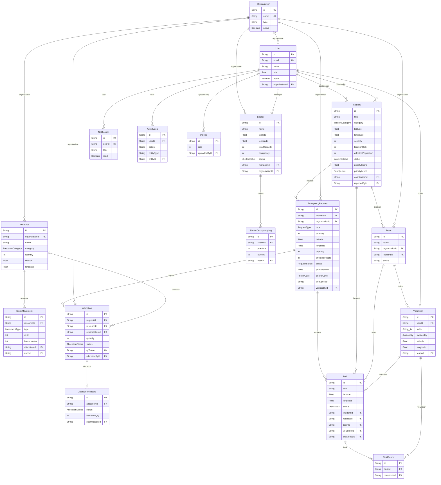

# Database Design

ReliefGrid uses **PostgreSQL** (tested on 16) through **Prisma ORM 6**. The schema lives in [`prisma/schema.prisma`](../prisma/schema.prisma); every change ships as a SQL migration in [`prisma/migrations`](../prisma/migrations). The 17 tables fall into five groups: identity and organizations, incidents and requests, inventory and allocation, shelters, and volunteers, plus an audit trail.

Data integrity does not depend only on application code. Stock can never go negative, shelter occupancy can never exceed capacity, and distribution records can never be edited or deleted. **The database itself rejects these**, so even a bug, a script or a manual query cannot break them.

## Entity-relationship diagram

Only keys and business-critical columns are shown (full definitions are in the schema). `||--o{` means one-to-many; `||--o|` means one-to-zero-or-one.

## Tables

### Identity and organizations

| Table | Purpose | Notes |
|---|---|---|
| `Organization` | Relief organizations (NGOs, agencies). The unit of multi-organization isolation. | `name` unique; `active` lets an admin suspend an organization without deleting its history. |
| `User` | Every account, with exactly one `role`. | `email` unique; `passwordHash` (bcrypt); `organizationId` binds relief-organization users (and optionally volunteers and shelter managers) to one organization; `active=false` blocks sign-in immediately. |
| `Volunteer` | Volunteer profile (1:1 with a `VOLUNTEER` user). | `skills` (text array, defaults to empty), `availability`, home `latitude`/`longitude` (used for matching), optional `teamId`. |
| `Team` | Group of volunteers, optionally deployed to an incident. | `incidentId` is the current deployment; `organizationId` is optional. |

### Incidents and emergency requests

| Table | Purpose | Notes |
|---|---|---|
| `Incident` | A disaster event: title, description, category, location text, GPS, severity (1–5), location risk (1–5), affected population, status, image. | Stores `priorityScore`/`priorityLevel` (recomputed on change and on demand) plus an optional manual `priorityOverride`. `coordinatorId` is the assigned response coordinator; `reportedById` the reporter. Response-time analytics use `reportedAt`, `firstResponseAt` and `resolvedAt`. |
| `EmergencyRequest` | A request for food, water, medical supplies, shelter, rescue or transport, optionally linked to an incident. | Quantity + unit, location + GPS, urgency (1–5), affected people, requester details, status, priority. `dedupeKey` (type + rounded coordinates) supports duplicate detection; `organizationId` is set when an organization submits the request. |

### Inventory, allocation and distribution

| Table | Purpose | Notes |
|---|---|---|
| `Resource` | A stock line owned by one organization (e.g. "Rice & lentil food pack" at a warehouse). | `quantity` is the **available** stock; `totalReceived` is the lifetime intake. `CHECK quantity >= 0`. |
| `StockMovement` | Append-only ledger of every stock change: register, restock, allocate, release, adjust, transfer in/out. | `delta` and `balanceAfter` give a full stock history per resource. `allocationId` links allocation and release movements to their allocation. |
| `Allocation` | Connects **request → resource → responsible organization**. | `quantity > 0` (CHECK); `status` follows the distribution state machine; `qrToken` (unique) is printed as a QR code for delivery verification. |
| `DistributionRecord` | Immutable history of each allocation's distribution (allocated, in transit, delivered, cancelled), with delivered quantity, notes and submitter. | A **database trigger rejects every `UPDATE` and `DELETE`**, so completed distribution records are preserved permanently. |

### Shelters

| Table | Purpose | Notes |
|---|---|---|
| `Shelter` | Name, location, GPS, total capacity, current occupancy, facilities (text array), status, manager. | `CHECK totalCapacity > 0` and `CHECK occupancy BETWEEN 0 AND totalCapacity`. Available capacity is derived (`totalCapacity - occupancy`) rather than stored, so it can never drift. |
| `ShelterOccupancyLog` | Append-only occupancy history: previous, current, capacity at the time, note, user. | Written in the same transaction as every occupancy change. |

### Volunteer work

| Table | Purpose | Notes |
|---|---|---|
| `Task` | Work assigned to a volunteer and/or team, optionally linked to an incident or request, with location and GPS. | Status: assigned → in progress → completed (or cancelled by a coordinator). |
| `FieldReport` | A volunteer's report on a task, with an optional photograph. | Kept permanently, including after the task is completed. |

### Cross-cutting

| Table | Purpose | Notes |
|---|---|---|
| `Notification` | In-app notifications per user (title, body, link, read flag). | Created inside the same transaction as the event that triggers them. |
| `ActivityLog` | Audit trail: who did what to which entity, with JSON details. | Written for every state change, including **rejected allocation attempts** and **priority changes**. It also drives the live-update stream (`/api/events`). |
| `Upload` | Uploaded images (bytes, content type, size, uploader). | Served only to signed-in users through `/api/uploads/:id`. `CHECK` keeps size within 5 MB and equal to the stored byte length. |

## Enumerations

| Enum | Values |
|---|---|
| `Role` | `SYSTEM_ADMIN`, `EMERGENCY_COORDINATOR`, `RELIEF_ORGANIZATION`, `VOLUNTEER`, `SHELTER_MANAGER` |
| `IncidentCategory` | `FLOOD`, `CYCLONE`, `EARTHQUAKE`, `FIRE`, `LANDSLIDE`, `INFRASTRUCTURE_FAILURE` |
| `IncidentStatus` | `REPORTED`, `VERIFIED`, `IN_PROGRESS`, `RESOLVED`, `CLOSED` |
| `PriorityLevel` | `LOW`, `MEDIUM`, `HIGH`, `CRITICAL` |
| `RequestType` | `FOOD`, `WATER`, `MEDICAL`, `SHELTER`, `RESCUE`, `TRANSPORT` |
| `RequestStatus` | `PENDING`, `VERIFIED`, `ASSIGNED`, `COMPLETED`, `REJECTED` |
| `ResourceCategory` | `FOOD`, `WATER`, `MEDICAL`, `EMERGENCY_KIT`, `BLANKET`, `RESCUE_EQUIPMENT`, `TRANSPORT` |
| `MovementType` | `REGISTER`, `RESTOCK`, `ALLOCATE`, `RELEASE`, `ADJUST`, `TRANSFER_IN`, `TRANSFER_OUT` |
| `AllocationStatus` | `ALLOCATED`, `IN_TRANSIT`, `DELIVERED`, `CANCELLED` |
| `ShelterStatus` | `OPEN`, `FULL`, `CLOSED` |
| `Availability` | `AVAILABLE`, `DEPLOYED`, `UNAVAILABLE` |
| `TaskStatus` | `ASSIGNED`, `IN_PROGRESS`, `COMPLETED`, `CANCELLED` |

## Integrity rules enforced by the database

| Rule | Mechanism |
|---|---|
| Stock can never go negative | `CHECK ("quantity" >= 0)` on `Resource`, plus conditional `UPDATE … WHERE quantity >= n` in the allocation transaction. |
| Allocations are positive | `CHECK ("quantity" > 0)` on `Allocation`. |
| Occupancy within capacity | `CHECK ("occupancy" >= 0 AND "occupancy" <= "totalCapacity")` and `CHECK ("totalCapacity" > 0)` on `Shelter`. |
| Severity and urgency are 1–5 | `CHECK` constraints on `Incident.severity` and `EmergencyRequest.urgency`. |
| Distribution records are permanent | Trigger `DistributionRecord_immutable` (`BEFORE UPDATE OR DELETE`) raises `DistributionRecord is immutable`. |
| Upload size | `CHECK ("size" > 0 AND "size" <= 5242880 AND octet_length("data") = "size")`. |
| Referential integrity | Foreign keys on every relation (optional parents use `ON DELETE SET NULL`). |
| Uniqueness | `User.email`, `Organization.name`, `Volunteer.userId` (one profile per user), `Allocation.qrToken`. |

### Concurrency

Allocation and occupancy changes run in a **single transaction** that first locks the affected row (`SELECT … FOR UPDATE` on the request, allocation or shelter). Stock is decremented with a guarded statement (`UPDATE "Resource" SET quantity = quantity - n WHERE id = … AND quantity >= n RETURNING quantity`). If any step fails, the whole transaction rolls back and inventory is untouched. The test suite fires parallel allocations at the same resource and checks that stock is never oversold.

## Indexes

Each index serves a known query pattern (34 in the initial migration):

| Index | Serves |
|---|---|
| `Incident(status, priorityScore)` | Priority-sorted incident queue filtered by status (dashboard, incident list, map). |
| `Incident(category)`, `Incident(reportedAt)`, `Incident(coordinatorId)` | Category filters and charts, recency sort and trends, "my incidents". |
| `EmergencyRequest(status, priorityScore)` | Priority-sorted request queue (pending / verified). |
| `EmergencyRequest(type)`, `(incidentId)`, `(createdAt)`, `(dedupeKey)` | Type filters, requests per incident, 14-day trend chart, duplicate lookups. |
| `Resource(organizationId, category)`, `Resource(category, quantity)` | Organization-scoped inventory; finding compatible stock for an allocation. |
| `StockMovement(resourceId, createdAt)` | Stock history timeline per resource. |
| `Allocation(requestId)`, `(resourceId)`, `(organizationId, status)` | Remaining need per request; allocations per resource; an organization's open distributions. |
| `DistributionRecord(allocationId, createdAt)` | Distribution timeline per allocation. |
| `Shelter(status)`, `Shelter(managerId)` | Open or available shelters (nearest-shelter search); a manager's shelters. |
| `ShelterOccupancyLog(shelterId, createdAt)` | Occupancy history chart. |
| `Volunteer(availability)`, `Volunteer(teamId)` | Availability matching; team rosters. |
| `Task(volunteerId, status)`, `Task(incidentId)` | "My tasks"; tasks per incident. |
| `FieldReport(taskId)` | Reports per task. |
| `Notification(userId, read, createdAt)` | Unread badge and notification feed. |
| `ActivityLog(entityType, entityId)`, `(createdAt)`, `(userId)` | Per-record history (incident or request timeline), the live-update poller and recent activity, per-user audit. |
| Unique: `User.email`, `Organization.name`, `Volunteer.userId`, `Allocation.qrToken` | Sign-in lookup, uniqueness, QR verification lookup. |

## Migrations

| Migration | Purpose |
|---|---|
| `20261121000000_init` | Full schema, CHECK constraints, distribution-record immutability trigger, indexes. |
| `20261124000000_volunteer_skills_default` | `Volunteer.skills` defaults to an empty array, so admin-created volunteer accounts no longer fail. |
| `20261124010000_uploads` | `Upload` table: images stored in Postgres, which works on read-only serverless file systems. |
| `20261124020000_incident_user_fks` | Foreign keys for `Incident.coordinatorId` and `Incident.reportedById` that the initial migration missed (found with `prisma migrate diff`). |

`prisma migrate diff --from-migrations prisma/migrations --to-schema-datamodel prisma/schema.prisma` reports **no difference**, so the migrations reproduce the schema exactly.

## Sample data

`npm run db:seed` truncates all tables and generates realistic data for Bangladesh (districts, coordinates, names and organizations). Dates are spread over the last 14 days so trends and response times are meaningful.

| Entity | Seeded | Required minimum |
|---|---:|---:|
| Organizations | 5 | 5 |
| Incidents | 60 | 50 |
| Emergency requests | 138 | 100 |
| Shelters | 24 | 20 |
| Volunteers | 110 | 100 |
| Resource records | 530 | 500 |
| Plus: users 139, allocations 76, distribution records 192, stock movements 682, occupancy logs 192, teams 12, tasks 90, field reports 50, notifications 158, activity entries 534 | | |
